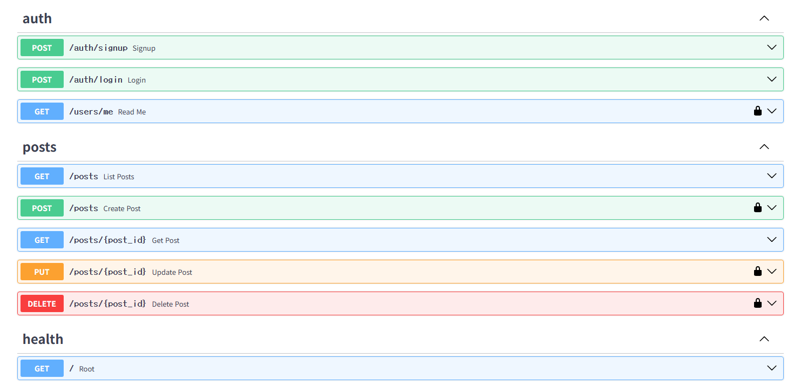

# 게시판 API (FastAPI + PostgreSQL)

회원가입, 로그인(JWT), 게시글 CRUD 되는 REST API.

- GitHub: (https://github.com/kimjmin31/CH2_CH3_work5)
- 배포 주소: http://(EC2 퍼블릭 IP):8000
- Swagger UI: http://(EC2 퍼블릭 IP):8000/docs

## 기술

FastAPI, SQLAlchemy 2.x, PostgreSQL(psycopg), PyJWT, pwdlib(argon2), uv

## API

| 메서드 | 경로 | 설명 | 로그인 |
|---|---|---|---|
| POST | /auth/signup | 회원가입 | |
| POST | /auth/login | 로그인 (access_token 받음) | |
| GET | /users/me | 내 정보 | O |
| GET | /posts?skip=0&limit=20 | 게시글 목록 | |
| GET | /posts/{post_id} | 게시글 상세 | |
| POST | /posts | 게시글 작성 | O |
| PUT | /posts/{post_id} | 게시글 수정 (작성자만) | O |
| DELETE | /posts/{post_id} | 게시글 삭제 (작성자만) | O |

다른 사람 글을 수정/삭제하면 `403`, 토큰이 없거나 만료되면 `401`, 이메일 형식이 틀리거나 비밀번호 8자 미만, 제목이 비어 있으면 `422`.

## 폴더 구조

```
app/
  main.py        앱 생성, 라우터 등록
  config.py      환경변수
  database.py    DB 연결, 세션
  models.py      User, Post (1:N)
  schemas.py     요청/응답 스키마 (Pydantic)
  auth.py        비밀번호 해시, JWT 발급/검증, 현재 사용자
  routers/users.py
  routers/posts.py
tests/test_api.py
```

## 로컬 실행

```bash
uv sync
cp .env.example .env    # DATABASE_URL, SECRET_KEY 입력
uv run fastapi dev app/main.py
```

http://localhost:8000/docs 에서 테스트하면 됨. 오른쪽 위 Authorize 누르면 username 칸이 나오는데 여기에 이메일 넣으면 됩니다.

테스트:

```bash
uv run pytest
```

## EC2 배포 (Ubuntu)

```bash
# 1. 패키지 설치
sudo apt update
sudo apt install -y postgresql git
curl -LsSf https://astral.sh/uv/install.sh | sh

# 2. DB 생성
sudo -u postgres psql -c "ALTER USER postgres PASSWORD '비밀번호';"
sudo -u postgres psql -c "CREATE DATABASE board;"

# 3. 코드 받기
git clone (https://github.com/kimjmin31/CH2_CH3_work5.git)
cd cd CH2_CH3_work5
cp .env.example .env    # 값 입력
uv sync

# 4. 실행 (터미널 종료해도 유지)
nohup uv run fastapi run app/main.py --port 8000 > server.log 2>&1 &
```

EC2 보안 그룹 인바운드 규칙에서 8000 포트 열어줘야 밖에서 접속됨.

## 실행 화면


